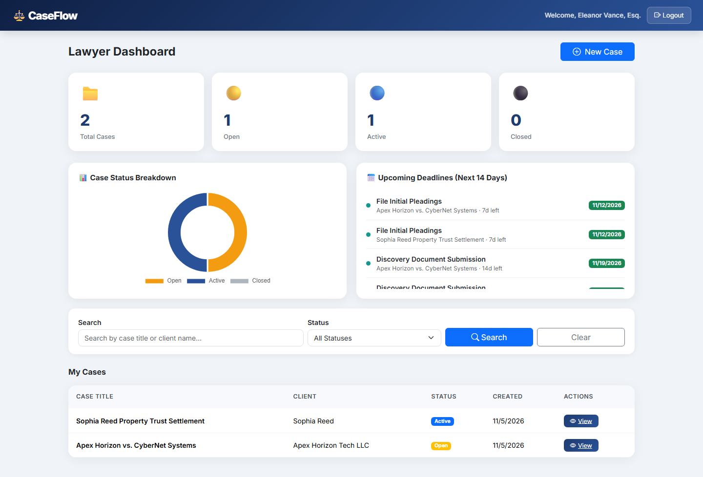
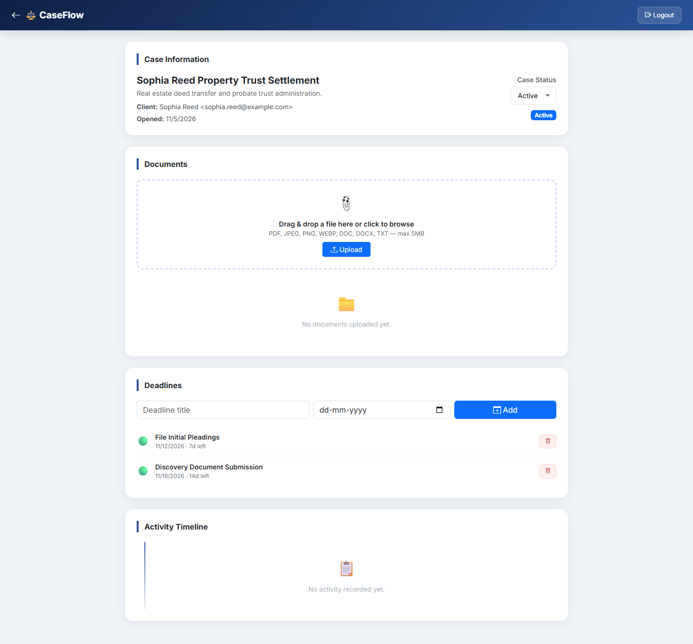
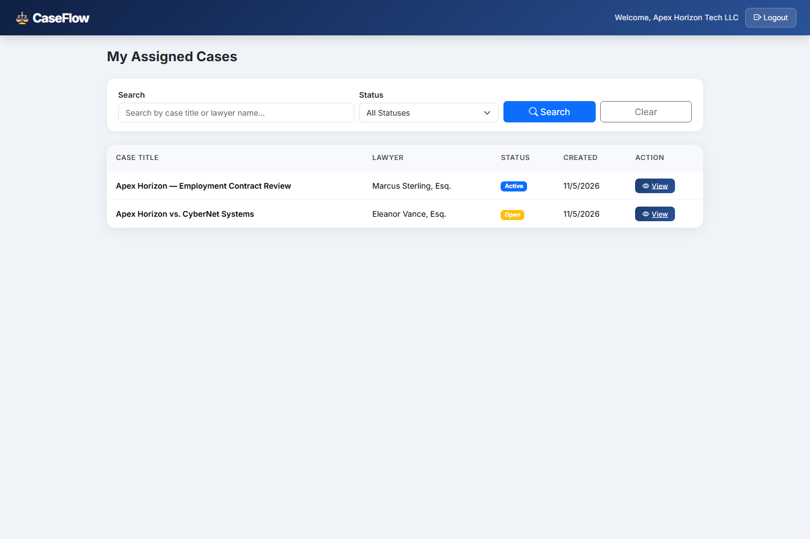
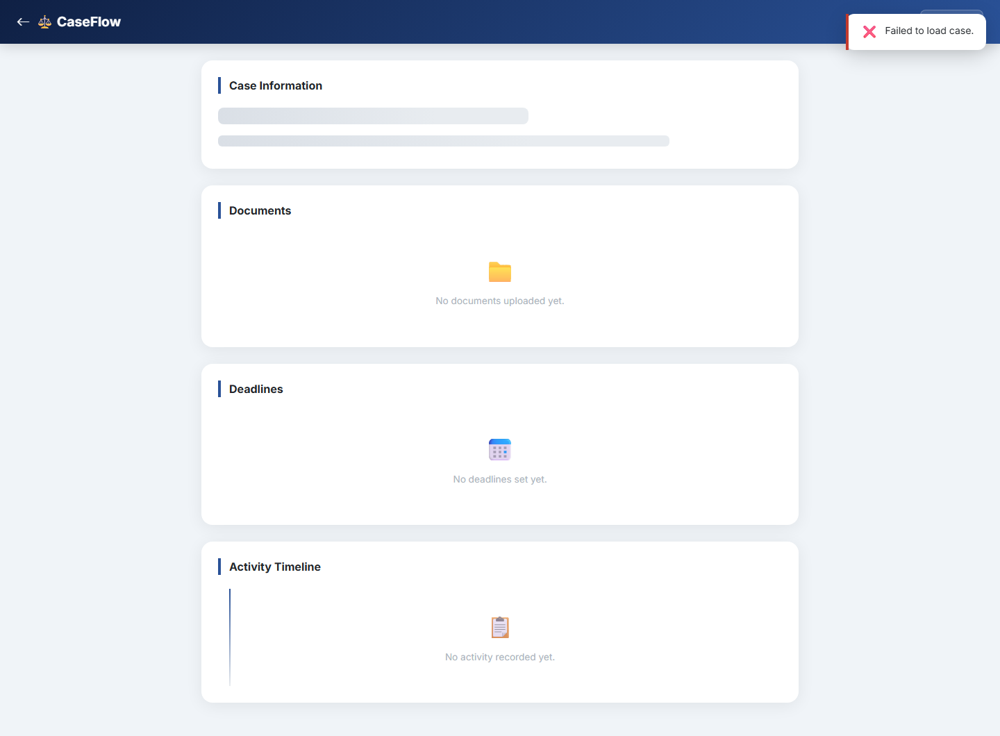
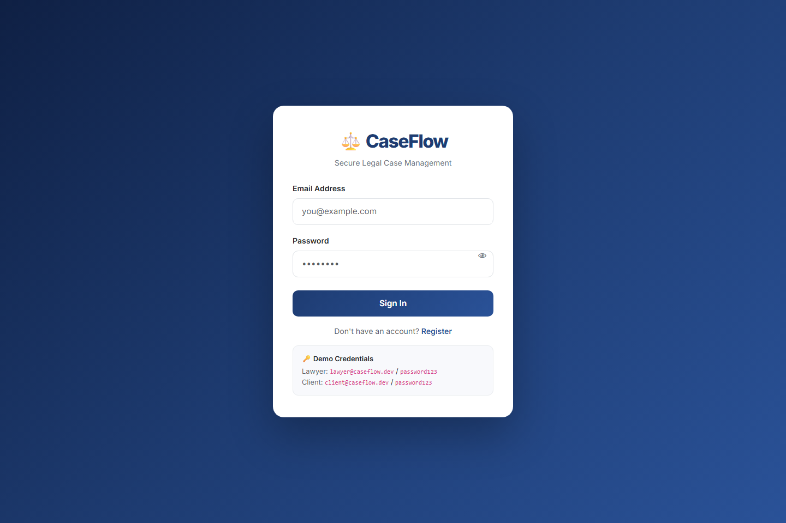

# ⚖️ CaseFlow — Legal Case Management Platform


> A production-quality, full-stack legal case management platform featuring role-based access control (Lawyers & Clients), security hardening, automated testing, immutable audit trails, document versioning, real-time deadline reminders, and responsive dashboards.

---

## 📸 Platform Screenshots & Visual Tour

### 1. Lawyer Analytics & Case Operations Dashboard
Interactive dashboard featuring real-time case distribution metrics (Chart.js doughnut breakdown), upcoming statutory deadlines (14-day window), case search, status filtering, and paginated case records.


---

### 2. Comprehensive Lawyer Case Detail View
Full case lifecycle view showing client details, drag-and-drop document uploads with version history tracking, deadline manager, and an immutable chronological audit trail.


---

### 3. Client Case Portal Dashboard
Tailored view for clients displaying their active legal proceedings, assigned legal counsel, and upcoming case deadlines.


---

### 4. Client Case Detail & Document Access
Secure portal allowing clients to view their legal timeline, read case updates, and download authorized case documents and exhibits.


---

### 5. Secure Authentication Portal
Dual-role JWT authentication portal supporting Lawyer and Client sign-in with live client-side validation and password complexity enforcement.


---

## ✨ Feature Highlights

| Feature | Details |
|---------|---------|
| **Role-Based Authentication** | Distinct Lawyer and Client portals, JWT with 1h expiry, bcrypt password hashing (cost factor 10) |
| **Security Hardening** | Helmet headers, multi-tier rate limiting (auth: 20/15min, API: 100/15min), environment-driven CORS, startup JWT verification |
| **Request Validation** | Zod schemas on all mutating endpoints; validation errors surfaced cleanly in UI with toast feedback |
| **IDOR Protection** | Strict ownership middleware (`ownership.js`) guarding every case, document, and deadline route — unauthorized queries return `403 Forbidden` |
| **Password Policy** | Minimum 8 characters + at least 1 digit, validated synchronously on client and backend |
| **Case Lifecycle Management** | Complete state machine (`Open` → `Active` → `Closed`), searchable by title/client, status filtering, and paginated lists |
| **Document Versioning** | Multer file uploads with MIME-type filtering (PDF, DOCX, TXT, PNG, JPG) and 5MB size limits; re-uploading an existing file increments version number and preserves version history |
| **Deadline Tracking & Reminders** | Urgency color coding (overdue/urgent/normal), daily scheduled automated email reminders via Nodemailer + `node-cron` |
| **Immutable Audit Trail** | Every case creation, status transition, document revision, and deadline change creates an append-only audit event displayed in a timeline |
| **Automated Test Suite** | 20 Jest + Supertest integration tests running on an isolated in-memory MongoDB instance (`mongodb-memory-server`) |
| **Continuous Integration (CI)** | GitHub Actions pipeline executing linting, dependency verification, and full automated test suite on every push and PR |
| **Idempotent Data Seeder** | `npm run seed` clears and populates realistic synthetic demo cases, clients, and deadlines safely on repeated executions |

---

## 🛠️ Tech Stack

| Layer | Technology |
|-------|-----------|
| **Frontend** | Vanilla JavaScript (ES6+), Bootstrap 5.3, Bootstrap Icons, Chart.js |
| **Backend** | Node.js (v18+), Express.js 4 |
| **Database** | MongoDB 6+, Mongoose ODM |
| **Authentication & Security** | JSON Web Tokens (`jsonwebtoken`), `bcryptjs`, `helmet`, `express-rate-limit`, `zod` |
| **File Management** | Multer (with strict extension & MIME whitelist, 5MB limit) |
| **Automated Reminders** | `nodemailer`, `node-cron` |
| **Testing & CI** | Jest 29, Supertest 7, `mongodb-memory-server`, GitHub Actions |

---

## 📂 Project Structure

```
CaseFlow/
├── .github/
│   └── workflows/
│       └── ci.yml               # GitHub Actions CI automated testing pipeline
├── backend/
│   ├── config/
│   │   └── db.js                # MongoDB connection handler
│   ├── middleware/
│   │   ├── auth.js              # JWT verification & requireRole middleware
│   │   ├── ownership.js         # IDOR ownership authorization (403 Forbidden)
│   │   └── validate.js          # Zod schema validation middleware
│   ├── models/
│   │   ├── User.js              # User schema with bcrypt hashing
│   │   ├── Case.js              # Case schema with lawyer & client relations
│   │   ├── Document.js          # Document schema with version history array
│   │   ├── Deadline.js          # Deadlines linked to cases
│   │   └── ActivityLog.js       # Immutable audit trail
│   ├── routes/
│   │   ├── auth.js              # /api/auth routes
│   │   ├── cases.js             # /api/cases routes + analytics
│   │   ├── documents.js         # /api/documents upload & versioned download
│   │   └── deadlines.js         # /api/deadlines CRUD
│   ├── services/
│   │   └── reminderService.js   # node-cron scheduled email reminder service
│   ├── tests/
│   │   ├── setup.js             # MongoMemoryServer lifecycle hooks
│   │   ├── auth.test.js         # Authentication integration tests
│   │   ├── cases.test.js        # Case management & analytics tests
│   │   ├── documents.test.js    # Document upload & versioning tests
│   │   └── deadlines.test.js    # Deadline tracking & reminder tests
│   ├── utils/
│   │   └── activityLogger.js    # Audit log utility
│   ├── validators/
│   │   └── index.js             # Zod validation schemas
│   ├── seed.js                  # Idempotent database seeder
│   ├── server.js                # Express app entrypoint & static host
│   ├── takeScreenshots.js       # Puppeteer automated UI screenshot generator
│   └── .env.example             # Template environment variables
├── frontend/
│   ├── pages/
│   │   ├── login.html           # Unified login & role-based redirection
│   │   ├── register.html        # Registration with live password validation
│   │   ├── lawyer-dashboard.html# Lawyer management center with Chart.js analytics
│   │   ├── lawyer-case-detail.html # Case detail with drag-and-drop & timeline
│   │   ├── client-dashboard.html# Client cases overview
│   │   └── client-case-view.html# Client case read-only portal & file access
│   ├── app.js                   # Client-side auth helpers, toasts, skeletons
│   └── index.html               # Root redirector & entry
├── output/
│   ├── 01-login.png             # Login portal screenshot
│   ├── 02-lawyer-dashboard.png  # Lawyer dashboard screenshot
│   ├── 03-lawyer-case-detail.png# Lawyer case detail screenshot
│   ├── 04-client-dashboard.png  # Client dashboard screenshot
│   └── 05-client-case-view.png  # Client case view screenshot
├── docs/
│   └── ARCHITECTURE.md          # Architectural decisions, sequence diagrams, threat model
└── README.md
```

---

## 🚀 Setup & Installation

### Prerequisites
- **Node.js** ≥ 18.0.0
- **MongoDB** running locally (`mongodb://127.0.0.1:27017`) or a MongoDB Atlas URI

### Quickstart

```bash
# 1. Clone repository
git clone https://github.com/naveena-zen/CaseFlow.git
cd CaseFlow

# 2. Install backend dependencies
cd backend
npm install

# 3. Configure environment variables
cp .env.example .env
# Edit .env and verify:
# PORT=5000
# MONGO_URI=mongodb://127.0.0.1:27017/caseflow
# JWT_SECRET=your_super_secret_jwt_key_here

# 4. Seed synthetic demo records (idempotent — safe to rerun)
npm run seed

# 5. Start the server
npm start
```

**Open your browser at:** `http://localhost:5000`

---

### Demo Credentials

| Role | Email | Password | Access Scope |
|------|-------|----------|--------------|
| **Lawyer** | `lawyer@caseflow.dev` | `password123` | Full case CRUD, document upload/versioning, deadline control, analytics |
| **Lawyer 2** | `m.sterling@caseflow.dev` | `password123` | Secondary lawyer account for cross-tenant IDOR verification |
| **Client** | `client@caseflow.dev` | `password123` | Assigned client portal for *Apex Horizon Tech LLC* cases |
| **Client 2** | `sophia.reed@example.com` | `password123` | Assigned client portal for *Sophia Reed* cases |

---

## 🧪 Automated Testing

CaseFlow comes with a comprehensive integration test suite using **Jest** and **Supertest**. Tests run against an isolated, zero-dependency in-memory MongoDB server (`mongodb-memory-server`), ensuring zero pollution of production or development databases.

```bash
cd backend

# Execute all integration tests
npm test

# Generate full code coverage report
npm run test:coverage
```

### Test Suite Summary
- **Total Test Suites:** 4 passed
- **Total Tests:** 20 passed (100% pass rate)
- **Execution Target:**
  - `auth.test.js`: User registration, password complexity validation, login JWT issuance, secret configuration guards.
  - `cases.test.js`: CRUD operations, role authorization, cross-lawyer IDOR isolation (403 Forbidden), search/pagination, analytics endpoints, audit logging.
  - `documents.test.js`: Multer file upload validation, MIME filtering, size limit enforcement, version incrementation, cross-client download restrictions.
  - `deadlines.test.js`: Deadline creation, updates, deletions, cross-lawyer authorization, automated reminder cron triggering.

---

## 🔌 API Endpoints Reference

### Authentication
| Method | Route | Access | Description |
|--------|-------|--------|-------------|
| `POST` | `/api/auth/register` | Public | Create new lawyer or client account |
| `POST` | `/api/auth/login` | Public | Authenticate credentials and receive 1h JWT |
| `GET` | `/api/auth/clients` | Lawyer | List registered clients for case assignment |

### Case Management
| Method | Route | Access | Description |
|--------|-------|--------|-------------|
| `GET` | `/api/cases` | Authenticated | List assigned cases (supports `?page=`, `?limit=`, `?status=`, `?search=`) |
| `GET` | `/api/cases/analytics/summary` | Authenticated | Fetch case status breakdown and upcoming 14-day deadlines |
| `GET` | `/api/cases/:id` | Assigned Party | Retrieve case details |
| `GET` | `/api/cases/:id/activity` | Assigned Party | Retrieve immutable audit timeline |
| `POST` | `/api/cases` | Lawyer | Create a new case record |
| `PATCH` | `/api/cases/:id/status` | Case Lawyer | Update case lifecycle status (`Open`, `Active`, `Closed`) |
| `DELETE` | `/api/cases/:id` | Case Lawyer | Delete a closed case |

### Document Management
| Method | Route | Access | Description |
|--------|-------|--------|-------------|
| `POST` | `/api/documents/upload/:caseId` | Assigned Party | Upload document (re-upload creates new version) |
| `GET` | `/api/documents/:caseId` | Assigned Party | List all documents for a case |
| `GET` | `/api/documents/download/:docId` | Assigned Party | Download latest document version (or `?version=N`) |
| `DELETE` | `/api/documents/:docId` | Assigned Party | Delete document and version history |

### Deadline Management
| Method | Route | Access | Description |
|--------|-------|--------|-------------|
| `POST` | `/api/deadlines/:caseId` | Case Lawyer | Schedule a new case deadline |
| `GET` | `/api/deadlines/:caseId` | Assigned Party | List deadlines for a case |
| `PUT` | `/api/deadlines/:id` | Case Lawyer | Modify deadline title or due date |
| `DELETE` | `/api/deadlines/:id` | Case Lawyer | Remove scheduled deadline |

---

## 🏛️ Architecture & Security Model

For complete architectural specifications, refer to **[docs/ARCHITECTURE.md](docs/ARCHITECTURE.md)**:
- High-level architecture diagram (Mermaid)
- Document upload and versioning sequence diagram
- Authentication & JWT lifecycle
- IDOR mitigation via `ownership.js` middleware
- Threat model and security considerations

---

## 📄 License

This project is licensed under the **MIT License**.
