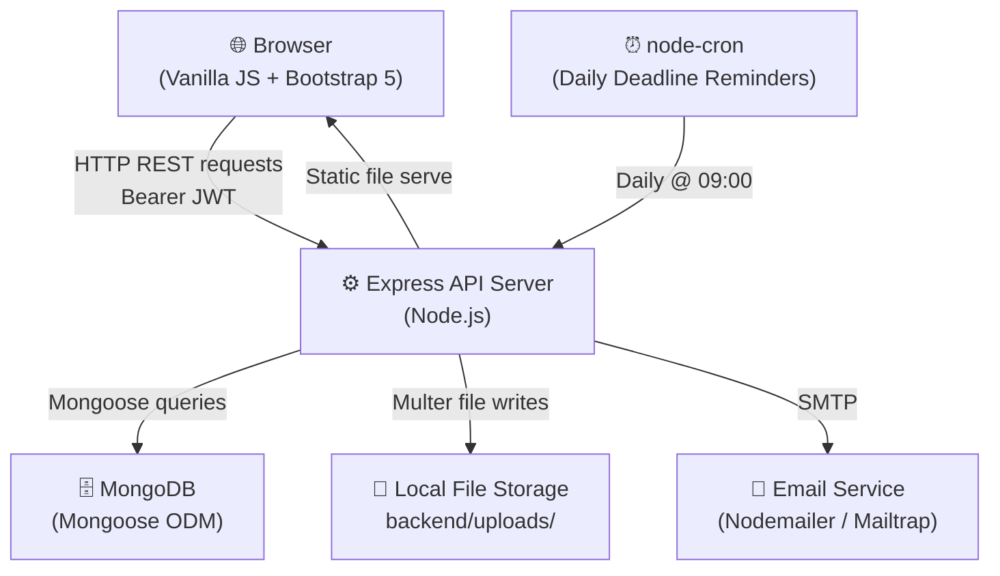
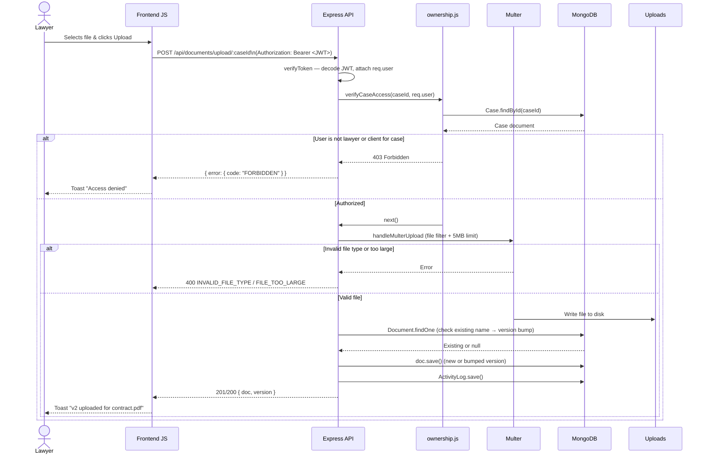

# CaseFlow – Architecture Overview

> **Version:** 2.0 (Phase 1 + Phase 2)  
> **Stack:** Node.js · Express · MongoDB · Vanilla JS · Bootstrap 5

---

## High-Level Architecture



---

## Sequence Diagram — Document Upload with Ownership Check



---

## Folder Structure

```
CaseFlow/
├── .github/
│   └── workflows/
│       └── ci.yml                # GitHub Actions CI pipeline
├── backend/
│   ├── config/
│   │   └── db.js                 # MongoDB connection
│   ├── middleware/
│   │   ├── auth.js               # JWT verification, requireRole()
│   │   ├── ownership.js          # IDOR protection middleware
│   │   └── validate.js           # Zod schema validation middleware
│   ├── models/
│   │   ├── User.js               # User schema (bcrypt pre-save hook)
│   │   ├── Case.js               # Case schema
│   │   ├── Document.js           # Document schema (versioned)
│   │   ├── Deadline.js           # Deadline schema
│   │   └── ActivityLog.js        # Audit trail schema
│   ├── routes/
│   │   ├── auth.js               # POST /register, /login, GET /clients
│   │   ├── cases.js              # CRUD + search/filter/pagination + analytics + activity
│   │   ├── documents.js          # Upload (versioned), download, delete
│   │   └── deadlines.js          # Create, list, update, delete
│   ├── services/
│   │   └── reminderService.js    # node-cron daily reminders via Nodemailer
│   ├── tests/
│   │   ├── setup.js              # MongoMemoryServer test DB setup
│   │   ├── auth.test.js
│   │   ├── cases.test.js
│   │   ├── documents.test.js
│   │   └── deadlines.test.js
│   ├── utils/
│   │   └── activityLogger.js     # Utility to write ActivityLog entries
│   ├── validators/
│   │   └── index.js              # Zod schemas (register, login, case, deadline)
│   ├── uploads/                  # User-uploaded files (gitignored except .gitkeep)
│   ├── seed.js                   # Idempotent demo data seeder
│   ├── server.js                 # Express app, middleware, routes
│   ├── .env                      # Local secrets (gitignored)
│   └── .env.example              # Template for environment variables
├── frontend/
│   ├── pages/
│   │   ├── login.html
│   │   ├── register.html
│   │   ├── lawyer-dashboard.html
│   │   ├── lawyer-case-detail.html
│   │   ├── client-dashboard.html
│   │   └── client-case-view.html
│   ├── app.js                    # Shared helpers: auth, toasts, validators, skeletons
│   └── index.html                # Landing page / auth redirect
├── docs/
│   └── ARCHITECTURE.md           # This document
├── .gitignore
└── README.md
```

---

## Auth Flow (JWT)

1. **Registration** — user submits name/email/password/role. Zod validates the request (8+ chars, at least one digit). Password is hashed via `bcrypt` (10 rounds) in a Mongoose `pre('save')` hook. A signed JWT (`expiresIn: '1h'`) is returned.
2. **Login** — credentials are validated, password compared with `bcrypt.compare`. A fresh 1h JWT is issued.
3. **Requests** — every protected route uses `verifyToken` middleware which decodes the JWT from the `Authorization: Bearer <token>` header. If `JWT_SECRET` is missing at startup, the server throws a fatal error.
4. **Role enforcement** — `requireRole('lawyer')` middleware returns `403 Forbidden` if the authenticated user's role doesn't match.

---

## Ownership / IDOR Middleware Pattern

All resource routes that operate on a specific case, document, or deadline first pass through an ownership middleware in [`ownership.js`](../backend/middleware/ownership.js):

| Middleware | Checks |
|---|---|
| `verifyCaseAccess` | User is the assigned lawyer **or** client for the case |
| `verifyCaseLawyer` | User is specifically the assigned lawyer (write operations) |
| `verifyDocumentAccess` | Resolves document → parent case → ownership check |
| `verifyDeadlineAccess` | Resolves deadline → parent case → ownership check |

All unauthorized access attempts return **`403 Forbidden`** (not 404), so attackers cannot enumerate resources by probing IDs.

---

## Daily Deadline Reminder Cron Job

- Implemented in [`reminderService.js`](../backend/services/reminderService.js) using `node-cron`.
- Schedules at **09:00 daily**: queries deadlines due within 24h (±12h) or 72h (±12h).
- Sends email reminders to both the **assigned lawyer** and **client** via Nodemailer (Mailtrap in dev).
- In test mode (`NODE_ENV=test`), email dispatch is skipped but reminder counts are still returned for assertion.

---

## Design Decisions & Tradeoffs

| Decision | Rationale | Tradeoff at Scale |
|---|---|---|
| **JWT (stateless) vs. Sessions** | No server-side session store needed; works well for a stateless REST API with a single server | At scale, token revocation requires a blocklist or short expiry refresh-token pattern |
| **Local disk storage vs. S3** | Simple, zero-cost setup for a portfolio/demo project; Multer handles it well | Local storage doesn't scale horizontally — switch to AWS S3 or Cloudflare R2 at production |
| **node-cron vs. a job queue (Bull/BullMQ)** | Minimal setup; runs in-process with no extra infrastructure | Not reliable under multi-instance deployments; Bull + Redis would provide distributed scheduling |
| **Vanilla JS vs. a frontend framework** | No build step, instant load, easy to understand; Bootstrap handles the UI layer | Complex state management (optimistic updates, caching) becomes painful; React or SvelteKit would be more maintainable at scale |

---

## What I'd Do Next

1. **AWS S3 / Cloudflare R2 for file storage** — Replace local `uploads/` with cloud object storage, enabling horizontal scaling and CDN-based document delivery.
2. **WebSocket push notifications** — Replace polling with `socket.io` to push real-time case updates, new document alerts, and deadline warnings to the browser.
3. **E-signature integration** — Add DocuSign or HelloSign webhooks so lawyers can request and track client document signatures directly from the case detail page.
4. **React / SvelteKit frontend migration** — Move from vanilla JS to a component framework for proper state management, route-level code splitting, and a richer interactive experience.
